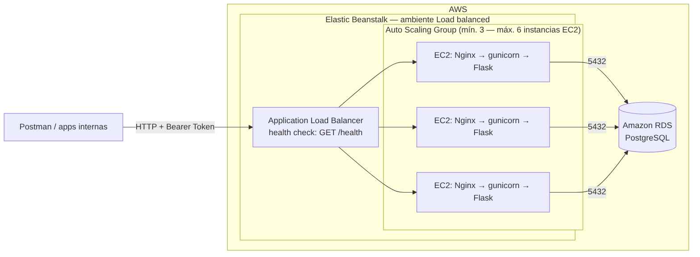
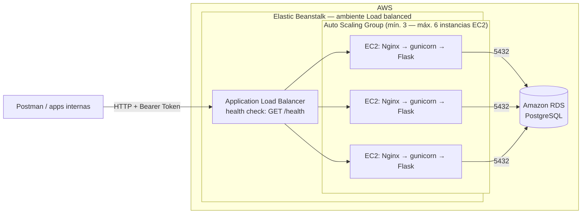
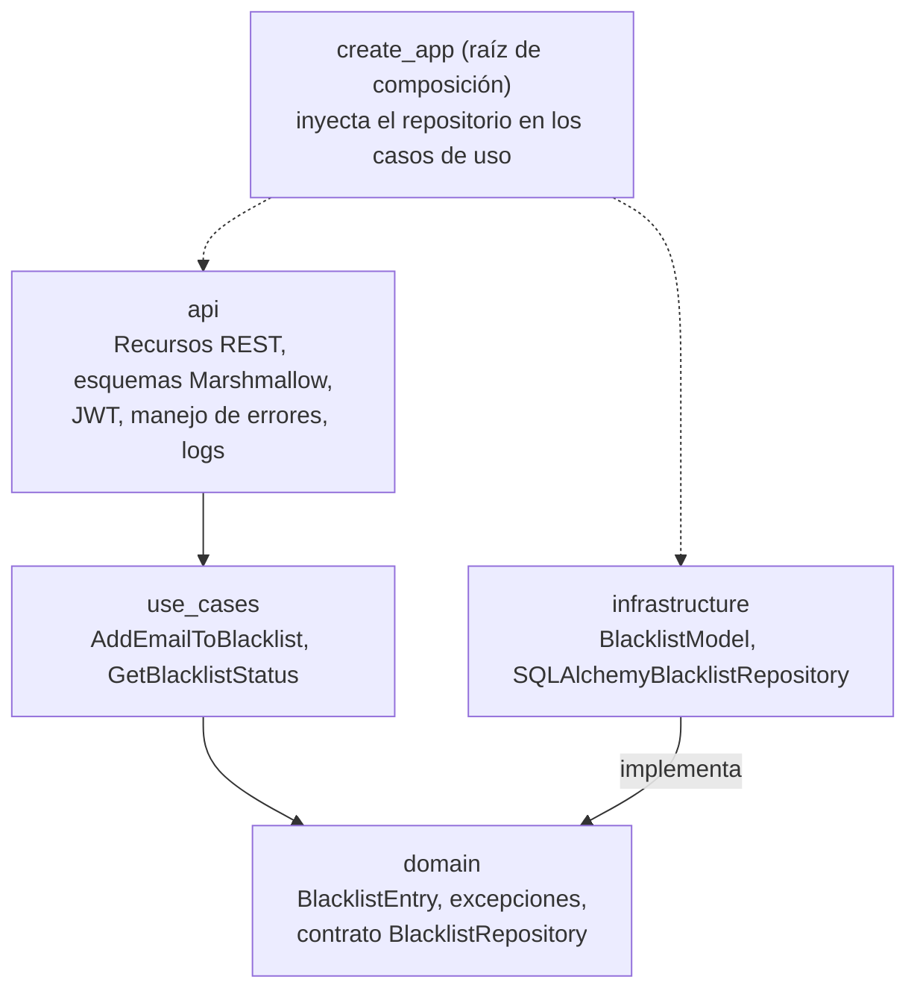
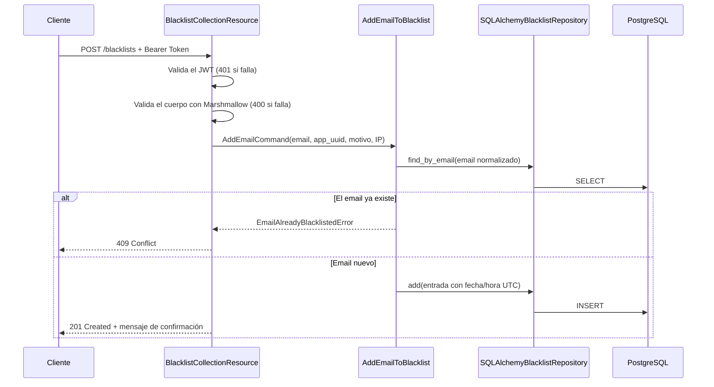

# Arquitectura — Blacklist Service

Los diagramas están en [Mermaid](https://mermaid.js.org/), que GitHub muestra
directamente. Las imágenes en `docs/img/` son las mismas, listas para el
documento de la entrega.

## 1. Despliegue en AWS

Despliegue manual sobre AWS Elastic Beanstalk (PaaS), sin CI/CD.

| Componente | Función |
|---|---|
| Application Load Balancer | Reparte el tráfico entre instancias y retira las que fallan el health check (`/health`). Agrega la IP del cliente en `X-Forwarded-For`. |
| Auto Scaling Group | Mantiene entre 3 y 6 instancias. Las estrategias de despliegue actúan sobre este grupo. |
| EC2 (Nginx → gunicorn → Flask) | Nginx es el proxy de la plataforma Python de Beanstalk; gunicorn ejecuta `application:application`. |
| Amazon RDS (PostgreSQL) | Base de datos compartida por todas las instancias. Solo acepta conexiones del security group de Beanstalk. |

La IP del cliente pasa por dos proxies (balanceador y Nginx); por eso en
Beanstalk se configura `PROXY_FIX_X_FOR=2`.

## 2. Capas (Clean Architecture)

Las dependencias apuntan hacia el dominio. El dominio no conoce Flask ni SQLAlchemy.

## 3. Flujo de `POST /blacklists`

## 4. Modelo de datos

| Columna | Tipo | Restricción |
|---|---|---|
| `id` | INTEGER | Llave primaria |
| `email` | VARCHAR(255) | Obligatorio, único, indexado, en minúsculas |
| `app_uuid` | VARCHAR(36) | Obligatorio |
| `blocked_reason` | VARCHAR(255) | Opcional |
| `ip_address` | VARCHAR(45) | Obligatorio (admite IPv6) |
| `created_at` | TIMESTAMP WITH TIME ZONE | Obligatorio |
